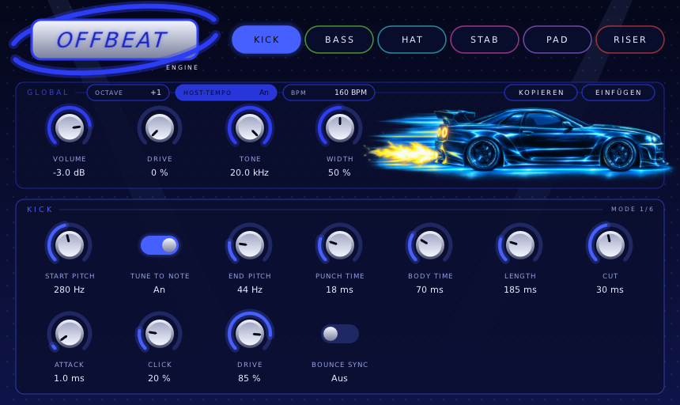
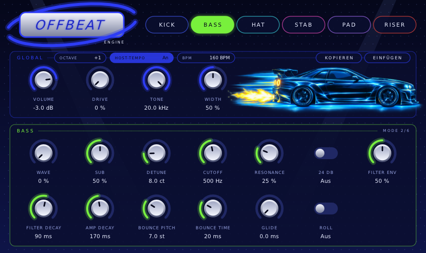
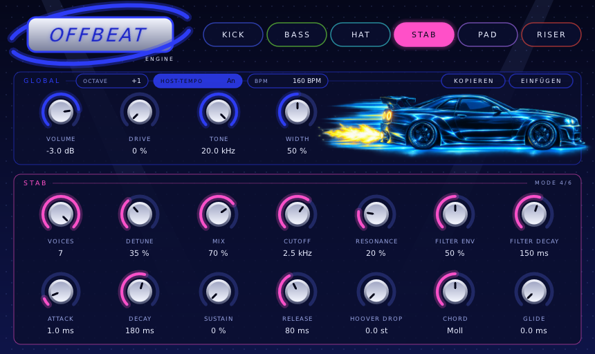
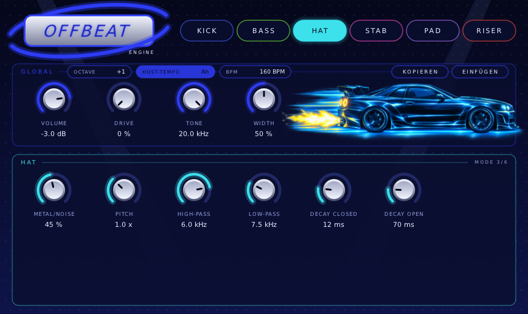
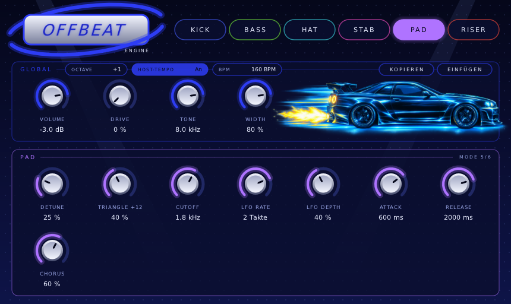

# Offbeat Engine

**Bounce-Synth für Hard Bounce und Bounce Techno:** Kick, Offbeat-Bass, Hats, Rave-Stabs, Pads und Riser in einem Plugin. Teil der [Offbeat-Familie](https://github.com/lukestark-glitch/offbeat).



| Formate | Systeme | Lizenz |
|---|---|---|
| VST3 · VST2 · AU · CLAP · LV2 | macOS (Intel + Apple Silicon) · Windows · Linux | ISC (frei nutzbar) |

## Inhalt

- [Was kann Offbeat Engine?](#was-kann-offbeat-engine)
- [Installation](#installation)
- [Bedienung](#bedienung)
- [Alle Regler](#alle-regler): [Global](#global) · [Kick](#kick) · [Bass](#bass) · [Hat](#hat) · [Stab](#stab-auch-lead) · [Pad](#pad) · [Riser](#riser)
- [Einstellungen als JSON](#einstellungen-als-json-kopieren--einfügen)
- [Presets zum Kopieren](#presets-zum-kopieren)
- [Selbst bauen und anpassen](#selbst-bauen-und-anpassen)

## Was kann Offbeat Engine?

Ein Plugin spielt immer einen **Modus**. Für einen Track legst du also mehrere Instanzen an: eine für die Kick, eine für den Bass, eine für die Hats und so weiter.

| Modus | Klang | Typisch |
|---|---|---|
| **Kick** | Sinus mit schnellem Pitch-Fall, Sättigung, Klick. Endet sauber vor dem Offbeat (Bounce Sync) | auf jedem Schlag, Taste F1 |
| **Bass** | zwei verstimmte Oszillatoren + Sub, Filter-Hüllkurve, „Bounce“ (Pitch von oben), Glide, Roll | auf dem Offbeat, Taste F2 |
| **Hat** | metallische Rechtecke + Rauschen, weich (wenig über 10 kHz). Taste A# = Open, sonst Closed | 16tel und Offbeats |
| **Stab** (auch Lead) | Supersaw bis 7 Stimmen, Akkord auf einer Taste (Moll/Dur), Hoover-Drop, Glide | Rave-Stabs, Leads |
| **Pad** | breite Supersaw-Fläche, Filter bewegt sich im Takt, Chorus | Breakdowns |
| **Riser** | Rauschen/Saw mit Filter-Sweep, Tonhöhe und Lautstärke steigen über n Takte, Sirene | vor dem Drop |

<p>
  
  
  
  
</p>

Außerdem:
- 13 Presets,
- Tempo vom Host (mit BPM-Regler als Ersatz),
- Zahleneingabe an jedem Regler,
- Einstellungen als JSON kopieren und einfügen,
- unter 150 Hz immer mono.

## Installation

**Kurz:** Lade unter [Releases](https://github.com/lukestark-glitch/offbeat-engine/releases) das ZIP für dein System, kopiere das passende Format in den Plugin-Ordner und lass deine DAW neu scannen.

| System | VST3 | AU | CLAP |
|---|---|---|---|
| macOS | `~/Library/Audio/Plug-Ins/VST3/` | `~/Library/Audio/Plug-Ins/Components/` | `~/Library/Audio/Plug-Ins/CLAP/` |
| Windows | `C:\Program Files\Common Files\VST3\` | – | `C:\Program Files\Common Files\CLAP\` |
| Linux | `~/.vst3/` | – | `~/.clap/` |

Die Dateien heißen `offbeat.vst3`, `offbeat.component` usw. (der alte Name). In der DAW heißt das Plugin **Offbeat Engine**.

> **Octave:** Der Standard **+1** ist für LMMS gedacht, weil LMMS Noten eine Oktave zu tief schickt. **In FL Studio, Ableton, Logic, Bitwig und Reaper stellst du Octave auf 0.**

Ausführlich, mit macOS-Gatekeeper, FL Studio, Ableton, Logic, Bitwig, Reaper, LMMS und Carla: **[Setup-Anleitung](https://github.com/lukestark-glitch/offbeat/blob/main/SETUP.md)**.

## Bedienung

| Aktion | Wirkung |
|---|---|
| Regler hoch/runter ziehen | Wert ändern; mit **Shift** fein |
| Mausrad über einem Regler | in kleinen Schritten ändern |
| Doppelklick | Standardwert |
| Klick auf den Wert unter dem Regler (oder Rechtsklick) | **Zahl eintippen**, Enter übernimmt, Esc bricht ab |
| Schalter anklicken | An/Aus |
| Reiter oben | Modus wechseln |
| **KOPIEREN** | aktuelle Einstellungen als JSON in die Zwischenablage |
| **EINFÜGEN** | JSON aus der Zwischenablage übernehmen, die Statuszeile zeigt, wie viele Werte gesetzt wurden |

**Eintippen:** Du gibst den Wert in der Einheit der Anzeige ein:
- `50` bei %-Reglern bedeutet 50 %,
- `1.5k` bedeutet 1500 Hz,
- Komma und Punkt gehen beide,
- bei Auswahl-Reglern tippst du den Namen (`Moll`), bei Schaltern `an` oder `aus`.

Presets wählst du über die Programm- bzw. Preset-Liste deiner DAW. Alternativ kopierst du eines der [JSON-Presets](#presets-zum-kopieren) und drückst EINFÜGEN.

## Alle Regler

### Global

Gilt für jeden Modus. Octave, Host-Tempo und BPM stehen als kleine Felder in der Kopfzeile von GLOBAL: Ziehen ändert den Wert, ein Klick ohne Ziehen öffnet das Eingabefeld.

| Regler | Bereich | Standard | Was er verändert | Beispiel |
|---|---|---|---|---|
| Mode | Kick … Riser | Kick | welcher Klang gespielt wird | Reiter „Bass“ für den Offbeat-Bass |
| Volume | −40 … +6 dB | −3 dB | Lautstärke am Ausgang; danach sitzt ein weicher Limiter | −6 dB, wenn die Spur zu laut in den Mixer geht |
| Drive | 0 … 100 % | 0 % | Sättigung auf alles: dichter, rauer, lauter wirkend | 30 % für einen dreckigeren Bass |
| Tone | 200 Hz … 20 kHz | 20 kHz | Low-Pass auf alles; nach links dumpfer | 4 kHz nimmt einem Pad die Schärfe |
| Width | 0 … 100 % | 50 % | Stereobreite; unter 150 Hz bleibt es immer mono | 80 % für ein breites Pad, 0 % = mono |
| Octave | −2 … +2 | +1 | verschiebt alle Noten in Oktaven | 0 in FL/Ableton/Logic, +1 in LMMS |
| Host-Tempo | An/Aus | An | An: Tempo und Takt kommen aus der DAW. Aus: es gilt BPM | aus, wenn Bounce Sync oder Roll nicht zum Song passen |
| BPM | 60 … 220 | 160 | Tempo, wenn kein Host-Tempo genutzt wird | 150 für einen langsameren Track ohne Host-Tempo |

### Kick

| Regler | Bereich | Standard | Was er verändert | Beispiel |
|---|---|---|---|---|
| Start Pitch | 100 … 500 Hz | 280 Hz | Tonhöhe am Anfang, also der „Punch“ | 350 Hz für mehr Knall, 200 Hz für runder |
| Tune to Note | An/Aus | An | An: Endton folgt der gespielten Taste (F1 ≈ 44 Hz). Aus: es gilt End Pitch | aus, wenn jede Taste dieselbe Kick spielen soll |
| End Pitch | 30 … 100 Hz | 43,65 Hz | Endton, wenn Tune to Note aus ist | 49 Hz (G1) für einen Track in G |
| Punch Time | 5 … 60 ms | 18 ms | wie schnell der steile erste Teil des Pitch-Falls ist | 10 ms = kurzer „Klick“-Punch, 30 ms = „Bwomp“ |
| Body Time | 20 … 200 ms | 75 ms | wie lange der langsame zweite Teil braucht (der „Bauch“) | 120 ms für eine längere, tonale Kick |
| Length | 60 … 600 ms | 185 ms | Gesamtlänge | 120 ms für eine kurze, trockene Kick |
| Cut | 5 … 60 ms | 30 ms | wie weich das Ende abgeschnitten wird | 10 ms = harter Abbruch, typisch Hard Bounce |
| Attack | 0 … 30 ms | 1 ms | weiche Einblendung am Anfang; 0 = harter Start mit Knack | 5 ms nimmt den Klick, die Kick wird weicher |
| Click | 0 … 100 % | 20 % | Lautstärke des Klicks (Rauschen 0,9–3,5 kHz) | 50 % für mehr Durchsetzung im Mix |
| Drive | 0 … 100 % | 50 % | Verzerrung der Kick; hoch = härter, mehr Obertöne | 85 % für „Hard Bounce“ (Preset), 30 % für sauber |
| Bounce Sync | An/Aus | Aus | Länge = 95 % einer Achtel beim aktuellen Tempo; endet genau vor dem Offbeat | an, damit Kick und Offbeat-Bass sich nie überlappen |

### Bass

| Regler | Bereich | Standard | Was er verändert | Beispiel |
|---|---|---|---|---|
| Wave | 0 … 100 % | 0 % | Wellenform: 0 = Sägezahn, 100 = Rechteck | 30 % für einen hohleren, gummiartigen Ton |
| Sub | 0 … 100 % | 50 % | Sinus eine Oktave tiefer (mono) | 80 % für mehr Druck auf großen Anlagen |
| Detune | 0 … 50 ct | 8 ct | Verstimmung der zwei Oszillatoren (links/rechts) | 20 ct für einen breiteren, schwebenden Bass |
| Cutoff | 40 Hz … 10 kHz | 500 Hz | Grundhelligkeit des Filters | 220 Hz für einen dunklen Rolling-Sub |
| Resonance | 0 … 100 % | 25 % | Betonung an der Filterfrequenz | 60 % für ein „quakiges“ Filter |
| 24 dB | An/Aus | Aus | steileres Filter: runder, weniger Obertöne | an für einen weichen Sub-Bass |
| Filter Env | 0 … 100 % | 50 % | wie weit das Filter beim Anschlag aufgeht | 80 % für einen „pluckigen“ Anschlag |
| Filter Decay | 5 … 1000 ms | 90 ms | wie schnell das Filter wieder zugeht | 45 ms für kürzeres „Plopp“ |
| Amp Decay | 20 … 2000 ms | 170 ms | wie lange der Ton klingt | 90 ms für kurze, knackige Offbeats |
| Bounce Pitch | 0 … 24 st | 7 st | Pitch-Sprung von oben beim Anschlag – der „Bounce“ | 14 st für einen übertriebenen Gummi-Bass |
| Bounce Time | 5 … 60 ms | 20 ms | wie schnell der Bounce auf den Grundton fällt | 35 ms = hörbarer „Wuup“-Effekt |
| Glide | 0 … 200 ms | 0 ms | Gleiten zwischen überlappend gespielten Noten | 60 ms für Rutscher zwischen Bassnoten |
| Roll | An/Aus | Aus | solange die Taste gehalten wird: Neuanschlag auf jedem 16tel | an + lange Note = rollender Bass |

### Hat

Taste **A#** (z. B. A#3) spielt eine **Open** Hat, alle anderen Tasten eine **Closed**. Eine Closed schneidet eine klingende Open ab.

| Regler | Bereich | Standard | Was er verändert | Beispiel |
|---|---|---|---|---|
| Metal/Noise | 0 … 100 % | 45 % | Mischung aus metallischem Klang und Rauschen | 70 % für eine rauschigere, weichere Hat |
| Pitch | 0,5 … 2 x | 1 x | Tonhöhe des metallischen Anteils | 1,3 x für eine hellere, kleinere Hat |
| High-Pass | 2 … 8 kHz | 6 kHz | schneidet Tiefen weg; höher = dünner | 4 kHz für mehr Körper |
| Low-Pass | 6 … 14 kHz | 7,5 kHz | schneidet Höhen weg; niedriger = weniger spitz | 10 kHz für mehr Glanz |
| Decay Closed | 3 … 50 ms | 12 ms | Ausklingen der Closed Hat (≈ 60 ms lang) | 6 ms für sehr kurze Ticks |
| Decay Open | 20 … 300 ms | 70 ms | Ausklingen der Open Hat (≈ 220 ms lang) | 120 ms für eine lange, offene Hat |

### Stab (auch Lead)

Bis zu 8 Noten gleichzeitig, jede als „Supersaw“ aus mehreren verstimmten Sägezähnen.

| Regler | Bereich | Standard | Was er verändert | Beispiel |
|---|---|---|---|---|
| Voices | 1 … 7 | 7 | Sägezähne pro Note; mehr = breiter, fetter | 3 für einen schlankeren Lead |
| Detune | 0 … 100 % | 30 % | Verstimmung der Sägezähne | 50 % für den klassischen Rave-Schwebe-Sound |
| Mix | 0 … 100 % | 70 % | Lautstärke der äußeren Sägezähne gegenüber den mittleren | 100 % = maximal breit |
| Cutoff | 100 Hz … 16 kHz | 3 kHz | Grundhelligkeit | 1,5 kHz für dunklere Stabs |
| Resonance | 0 … 100 % | 20 % | Betonung an der Filterfrequenz | 50 % für einen „zwitschernden“ Stab |
| Filter Env | 0 … 100 % | 40 % | Filter öffnet beim Anschlag | 70 % für mehr „Pling“ |
| Filter Decay | 5 … 2000 ms | 200 ms | wie schnell das Filter zugeht | 80 ms für sehr kurze Stabs |
| Attack | 0,5 … 2000 ms | 1 ms | Einschwingen | 300 ms für einen anschwellenden Lead |
| Decay | 5 … 3000 ms | 250 ms | Abfall nach dem Anschlag | 150 ms für kurze Stabs |
| Sustain | 0 … 100 % | 30 % | Pegel, solange die Taste gehalten wird | 0 % = reiner Stab, 70 % = Lead |
| Release | 5 … 5000 ms | 120 ms | Ausklingen nach dem Loslassen | 500 ms für Leads |
| Hoover Drop | 0 … 24 st | 0 st | Ton rutscht beim Loslassen so weit nach unten | 12 st für den Hoover-„Absturz“ |
| Chord | Aus / Moll / Dur | Aus | eine Taste spielt einen Dreiklang | Moll: F spielt F–As–C |
| Glide | 0 … 500 ms | 0 ms | Gleiten von der vorigen zur neuen Note | 80 ms für einen Lead mit Rutschern |

### Pad

| Regler | Bereich | Standard | Was er verändert | Beispiel |
|---|---|---|---|---|
| Detune | 0 … 100 % | 25 % | Verstimmung der Sägezähne | 50 % für eine sehr breite Fläche |
| Triangle +12 | 0 … 100 % | 40 % | Dreieck eine Oktave höher: weicher, glasiger | 80 % für ein „Milchglas“-Pad |
| Cutoff | 100 Hz … 12 kHz | 1,8 kHz | Grundhelligkeit | 800 Hz für ein dunkles Pad im Breakdown |
| LFO Rate | 1/4 … 4 Takte | 2 Takte | Tempo der Filter-Bewegung (synchron zum Tempo) | 1/4 für ein pulsierendes Pad |
| LFO Depth | 0 … 100 % | 40 % | Stärke der Filter-Bewegung | 0 % = statisch |
| Attack | 5 … 5000 ms | 600 ms | Einblenden | 2000 ms für langsames Aufblühen |
| Release | 20 … 8000 ms | 2000 ms | Ausklingen | 4000 ms für lange Übergänge |
| Chorus | 0 … 100 % | 60 % | Stärke des Stereo-Chorus | 100 % für maximale Bewegung |

### Riser

Taste halten, dann steigt der Klang über die eingestellte Zahl Takte an, synchron zum Tempo (4/4).

| Regler | Bereich | Standard | Was er verändert | Beispiel |
|---|---|---|---|---|
| Bars | 1 … 32 | 8 | Länge des Anstiegs in Takten | 16 für einen langen Build-up |
| Noise/Saw | 0 … 100 % | 40 % | Mischung aus Rauschen (0) und Sägezahn (100) | 0 % für einen reinen Rausch-Riser |
| Cutoff Start | 100 Hz … 20 kHz | 300 Hz | Filter am Anfang | 1 kHz für einen helleren Start |
| Cutoff End | 100 Hz … 20 kHz | 12 kHz | Filter am Ende | 18 kHz für ein grelles Ende |
| Pitch Rise | 0 … 24 st | 12 st | wie weit die Tonhöhe steigt | 24 st = zwei Oktaven |
| Volume Rise | 0 … 100 % | 100 % | wie stark es lauter wird | 50 % für einen gleichmäßigeren Riser |
| Siren Depth | 0 … 12 st | 0 st | Sirene: Tonhöhe schwingt auf und ab | 5 st für eine Rave-Sirene |
| Siren Rate | 1/1 … 1/16 | 1/4 | Tempo der Sirene (synchron) | 1/8 für schnelles Jaulen |

## Einstellungen als JSON (KOPIEREN / EINFÜGEN)

- **KOPIEREN** legt Modus, globale Regler, Oktave und Tempo sowie alle Regler des aktiven Modus als JSON in die Zwischenablage.
- **EINFÜGEN** liest ein JSON aus der Zwischenablage und setzt jeden genannten Regler. Regler, die nicht vorkommen, bleiben, wie sie sind.

So kannst du Sounds als Text speichern, teilen oder dir von jemandem (oder einer KI) schicken lassen.

```json
{
  "mode": "Kick",
  "volume": -3,
  "kick_start": 260,
  "kick_attack": 3,
  "kick_drive": 0.8,
  "kick_sync": true
}
```

**Regeln:**
- **Schlüssel** sind die Kurznamen (Liste unten).
- **Zahlen** stehen in der Einheit des Plugins (Hz, ms, dB, st, ct).
- **%-Regler** werden als **0 … 1** geschrieben: `0.8` bedeutet 80 %.
- **Auswahl-Regler** gehen als Name oder Nummer: `"mode": "Bass"`, `"stab_chord": "Moll"`, `"pad_lfo_rate": "1 Takt"`, `"riser_rate": "1/8"`.
- **Schalter** gehen als `true`/`false` (oder `1`/`0`).
- **Grenzen:** Zu große oder zu kleine Werte werden auf den erlaubten Bereich begrenzt.
- **Fehler:** Unbekannte oder ungültige Einträge meldet die Statuszeile, der Rest wird trotzdem gesetzt.

**Kurznamen**

| Bereich | Schlüssel |
|---|---|
| Global | `mode` `volume` `drive` `tone` `width` `octave` `tempo_host` `tempo_bpm` |
| Kick | `kick_start` `kick_tune` `kick_end` `kick_punch` `kick_body` `kick_length` `kick_cut` `kick_attack` `kick_click` `kick_drive` `kick_sync` |
| Bass | `bass_wave` `bass_sub` `bass_detune` `bass_cutoff` `bass_reso` `bass_slope` `bass_envamt` `bass_fdecay` `bass_adecay` `bass_bounce` `bass_btime` `bass_glide` `bass_roll` |
| Hat | `hat_mix` `hat_pitch` `hat_hp` `hat_lp` `hat_closed` `hat_open` |
| Stab | `stab_voices` `stab_detune` `stab_mix` `stab_cutoff` `stab_reso` `stab_envamt` `stab_fdecay` `stab_attack` `stab_decay` `stab_sustain` `stab_release` `stab_hoover` `stab_chord` `stab_glide` |
| Pad | `pad_detune` `pad_tri` `pad_cutoff` `pad_lfo_rate` `pad_lfo_depth` `pad_attack` `pad_release` `pad_chorus` |
| Riser | `riser_bars` `riser_mix` `riser_start` `riser_end` `riser_pitch` `riser_vol` `riser_siren` `riser_rate` |

Der Offline-Renderer versteht dasselbe Format: `bin/offbeat-render --json sound.json --note F2 --out sound.wav`.

## Presets zum Kopieren

Jedes Preset als JSON, genau so, wie KOPIEREN es ausgibt. Block kopieren, im Plugin **EINFÜGEN** drücken, fertig. Danach kannst du einzelne Werte im JSON ändern und wieder einfügen.

<details><summary><b>1. Kick - Hard Bounce</b></summary>

```json
{
  "mode": "Kick",
  "volume": -3,
  "drive": 0,
  "tone": 20000,
  "width": 0.5,
  "octave": 1,
  "tempo_host": true,
  "tempo_bpm": 160,
  "kick_start": 280,
  "kick_tune": true,
  "kick_end": 43.65,
  "kick_punch": 18,
  "kick_body": 70,
  "kick_length": 185,
  "kick_cut": 30,
  "kick_attack": 1,
  "kick_click": 0.2,
  "kick_drive": 0.85,
  "kick_sync": false
}
```

</details>
<details><summary><b>2. Kick - Bounce Soft</b></summary>

```json
{
  "mode": "Kick",
  "volume": -3,
  "drive": 0,
  "tone": 20000,
  "width": 0.5,
  "octave": 1,
  "tempo_host": true,
  "tempo_bpm": 160,
  "kick_start": 240,
  "kick_tune": true,
  "kick_end": 43.65,
  "kick_punch": 18,
  "kick_body": 75,
  "kick_length": 185,
  "kick_cut": 40,
  "kick_attack": 1,
  "kick_click": 0.08,
  "kick_drive": 0.6,
  "kick_sync": false
}
```

</details>
<details><summary><b>3. Bass - Offbeat F2</b></summary>

```json
{
  "mode": "Bass",
  "volume": -3,
  "drive": 0,
  "tone": 20000,
  "width": 0.5,
  "octave": 1,
  "tempo_host": true,
  "tempo_bpm": 160,
  "bass_wave": 0,
  "bass_sub": 0.5,
  "bass_detune": 8,
  "bass_cutoff": 500,
  "bass_reso": 0.25,
  "bass_slope": false,
  "bass_envamt": 0.5,
  "bass_fdecay": 90,
  "bass_adecay": 170,
  "bass_bounce": 7,
  "bass_btime": 20,
  "bass_glide": 0,
  "bass_roll": false
}
```

</details>
<details><summary><b>4. Bass - Rubber</b></summary>

```json
{
  "mode": "Bass",
  "volume": -3,
  "drive": 0,
  "tone": 20000,
  "width": 0.5,
  "octave": 1,
  "tempo_host": true,
  "tempo_bpm": 160,
  "bass_wave": 0.3,
  "bass_sub": 0.5,
  "bass_detune": 8,
  "bass_cutoff": 500,
  "bass_reso": 0.25,
  "bass_slope": false,
  "bass_envamt": 0.5,
  "bass_fdecay": 90,
  "bass_adecay": 260,
  "bass_bounce": 14,
  "bass_btime": 35,
  "bass_glide": 60,
  "bass_roll": false
}
```

</details>
<details><summary><b>5. Bass - Late Bounce</b></summary>

```json
{
  "mode": "Bass",
  "volume": -3,
  "drive": 0,
  "tone": 20000,
  "width": 0.5,
  "octave": 1,
  "tempo_host": true,
  "tempo_bpm": 160,
  "bass_wave": 0,
  "bass_sub": 0.5,
  "bass_detune": 8,
  "bass_cutoff": 500,
  "bass_reso": 0.25,
  "bass_slope": false,
  "bass_envamt": 0.6,
  "bass_fdecay": 45,
  "bass_adecay": 90,
  "bass_bounce": 7,
  "bass_btime": 12,
  "bass_glide": 0,
  "bass_roll": false
}
```

</details>
<details><summary><b>6. Bass - Rolling Sub</b></summary>

```json
{
  "mode": "Bass",
  "volume": -3,
  "drive": 0,
  "tone": 20000,
  "width": 0.5,
  "octave": 1,
  "tempo_host": true,
  "tempo_bpm": 160,
  "bass_wave": 0,
  "bass_sub": 0.8,
  "bass_detune": 8,
  "bass_cutoff": 220,
  "bass_reso": 0.25,
  "bass_slope": false,
  "bass_envamt": 0.35,
  "bass_fdecay": 60,
  "bass_adecay": 110,
  "bass_bounce": 0,
  "bass_btime": 20,
  "bass_glide": 0,
  "bass_roll": true
}
```

</details>
<details><summary><b>7. Hat - Closed Soft</b></summary>

```json
{
  "mode": "Hat",
  "volume": -3,
  "drive": 0,
  "tone": 20000,
  "width": 0.5,
  "octave": 1,
  "tempo_host": true,
  "tempo_bpm": 160,
  "hat_mix": 0.45,
  "hat_pitch": 1,
  "hat_hp": 6000,
  "hat_lp": 7500,
  "hat_closed": 12,
  "hat_open": 70
}
```

</details>
<details><summary><b>8. Hat - Open Soft</b></summary>

```json
{
  "mode": "Hat",
  "volume": -3,
  "drive": 0,
  "tone": 20000,
  "width": 0.5,
  "octave": 1,
  "tempo_host": true,
  "tempo_bpm": 160,
  "hat_mix": 0.5,
  "hat_pitch": 1,
  "hat_hp": 6000,
  "hat_lp": 7000,
  "hat_closed": 12,
  "hat_open": 70
}
```

</details>
<details><summary><b>9. Stab - Rave</b></summary>

```json
{
  "mode": "Stab",
  "volume": -3,
  "drive": 0,
  "tone": 20000,
  "width": 0.5,
  "octave": 1,
  "tempo_host": true,
  "tempo_bpm": 160,
  "stab_voices": 7,
  "stab_detune": 0.35,
  "stab_mix": 0.7,
  "stab_cutoff": 2500,
  "stab_reso": 0.2,
  "stab_envamt": 0.5,
  "stab_fdecay": 150,
  "stab_attack": 1,
  "stab_decay": 180,
  "stab_sustain": 0,
  "stab_release": 80,
  "stab_hoover": 0,
  "stab_chord": "Moll",
  "stab_glide": 0
}
```

</details>
<details><summary><b>10. Lead - Flow</b></summary>

```json
{
  "mode": "Stab",
  "volume": -3,
  "drive": 0,
  "tone": 20000,
  "width": 0.5,
  "octave": 1,
  "tempo_host": true,
  "tempo_bpm": 160,
  "stab_voices": 5,
  "stab_detune": 0.2,
  "stab_mix": 0.7,
  "stab_cutoff": 4000,
  "stab_reso": 0.2,
  "stab_envamt": 0.25,
  "stab_fdecay": 200,
  "stab_attack": 5,
  "stab_decay": 400,
  "stab_sustain": 0.7,
  "stab_release": 450,
  "stab_hoover": 0,
  "stab_chord": "Aus",
  "stab_glide": 80
}
```

</details>
<details><summary><b>11. Pad - Milchglas</b></summary>

```json
{
  "mode": "Pad",
  "volume": -3,
  "drive": 0,
  "tone": 8000,
  "width": 0.8,
  "octave": 1,
  "tempo_host": true,
  "tempo_bpm": 160,
  "pad_detune": 0.25,
  "pad_tri": 0.4,
  "pad_cutoff": 1800,
  "pad_lfo_rate": "2 Takte",
  "pad_lfo_depth": 0.4,
  "pad_attack": 600,
  "pad_release": 2000,
  "pad_chorus": 0.6
}
```

</details>
<details><summary><b>12. Riser - 8 Takte</b></summary>

```json
{
  "mode": "Riser",
  "volume": -3,
  "drive": 0,
  "tone": 20000,
  "width": 0.5,
  "octave": 1,
  "tempo_host": true,
  "tempo_bpm": 160,
  "riser_bars": 8,
  "riser_mix": 0.4,
  "riser_start": 300,
  "riser_end": 12000,
  "riser_pitch": 12,
  "riser_vol": 1,
  "riser_siren": 0,
  "riser_rate": "1/4"
}
```

</details>
<details><summary><b>13. Siren - 16 Takte</b></summary>

```json
{
  "mode": "Riser",
  "volume": -3,
  "drive": 0,
  "tone": 20000,
  "width": 0.5,
  "octave": 1,
  "tempo_host": true,
  "tempo_bpm": 160,
  "riser_bars": 16,
  "riser_mix": 0.9,
  "riser_start": 1500,
  "riser_end": 8000,
  "riser_pitch": 7,
  "riser_vol": 0.6,
  "riser_siren": 5,
  "riser_rate": "1/4"
}
```

</details>

## Selbst bauen und anpassen

```sh
git clone --recurse-submodules https://github.com/lukestark-glitch/offbeat-engine
cd offbeat-engine
make          # alle Formate nach bin/ + Offline-Renderer
make check    # jeden Modus rendern und gegen feste Ziele prüfen
make install  # macOS: in ~/Library/Audio/Plug-Ins kopieren und signieren
```

Was du für Windows und Linux brauchst, steht in der [Setup-Anleitung](https://github.com/lukestark-glitch/offbeat/blob/main/SETUP.md#5-selbst-bauen). Wie der Code aufgebaut ist und wie du Regler, Presets oder ganze Modi hinzufügst, erklärt **[docs/CODE.md](docs/CODE.md)**.

Einzige Abhängigkeit ist [DPF](https://github.com/DISTRHO/DPF) (als Submodule).

## Lizenz

[ISC](LICENSE): Du darfst den Code und die Plugins frei nutzen, verändern und weitergeben, auch kommerziell. Für DPF gilt seine eigene ISC-Lizenz.
